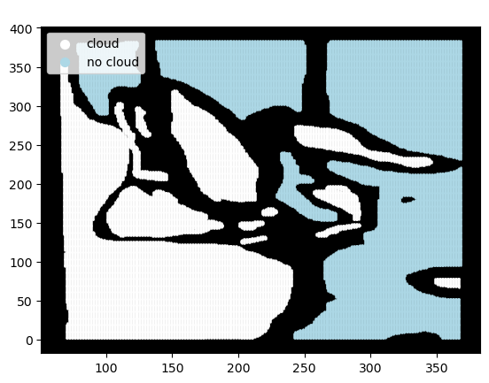
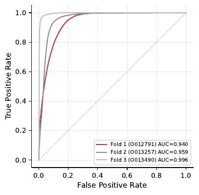
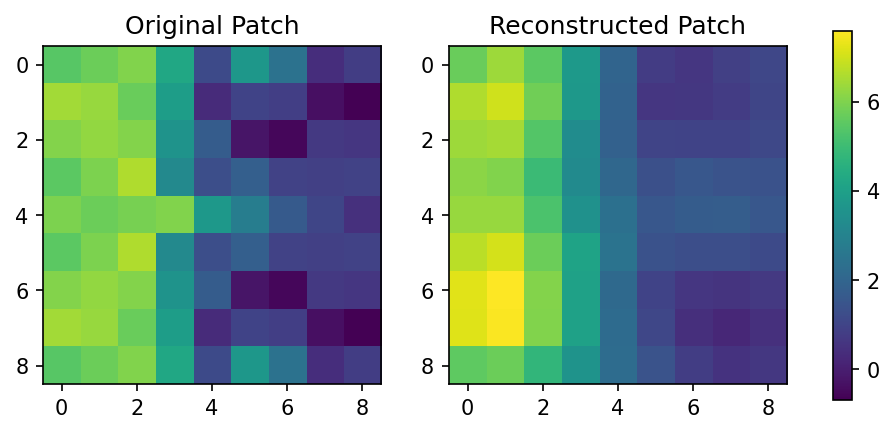

# Satellite Cloud Detection in the Arctic

**Can we tell clouds from snow and ice in satellite images?** Over the Arctic, clouds and frozen surfaces look nearly identical to standard sensors, which makes cloud coverage hard to measure for climate research. This project classifies pixels from NASA's MISR satellite instrument as cloud or clear surface, combining expert-designed features, hand-engineered interactions and features learned by an autoencoder.

*Team project, STAT 214 (Data Science Practice), UC Berkeley, Spring 2026.*



## Results

- **Best model: gradient boosting** on the top 5 features plus autoencoder embeddings, with ROC-AUC between 0.940 and 0.996 on images it never saw during training.
- **Learned features help every model.** Adding 16 autoencoder dimensions raised ROC-AUC by +0.116 for logistic regression, +0.096 for random forest and +0.041 for gradient boosting.
- **Nonlinear models win.** Logistic regression plateaued around 0.92 AUC while tree-based models reached about 0.96, so the cloud/surface boundary is not linear.
- **Engineered feature:** the NDAI × SD interaction was the strongest single feature (AUC 0.944).
- **Where it struggles:** errors concentrate along cloud edges, where cloud and surface readings overlap.



## Approach

1. **Exploratory analysis** of 164 MISR images (5 camera angles plus 3 expert features per pixel), with 3 images labeled by experts.
2. **Feature engineering:** univariate AUC and Glass's delta to rank features, then interaction and log-transformed features (NDAI × SD, log(SD), NDAI × log(SD)).
3. **Autoencoder:** a convolutional autoencoder trained on image patches across all 164 images to learn 8- and 16-dimensional embeddings.
4. **Modeling:** logistic regression (L1 and L2), random forest, gradient boosting and an RBF SVM, compared on three feature sets.
5. **Validation:** leave-one-image-out cross-validation, because pixels within one image are spatially correlated and a random split would overstate accuracy.
6. **Stability checks** on feature sets, thresholds and data perturbations, plus an interactive results dashboard.



## My contributions

I led the **exploratory data analysis** of the labeled and unlabeled images and developed the **domain-informed engineered features** (including NDAI × SD) that fed the modeling pipeline.

**Team:** Donjhai Holland, Larissa, Keyi and Lyla. Larissa coordinated the project and explored threshold optimization; Keyi led model training and evaluation and built the dashboard; Lyla led autoencoder development and tuning.

## Repository structure

```
code/
  part1_eda.ipynb                        # exploratory data analysis
  part2_autoencoder.py, patchdataset.py  # autoencoder model and patch dataset
  part2_run_autoencoder.py, configs/     # training runs and configs
  part3_manual_feature_engineering.py    # engineered features
  part3_gen_embeddings.py                # embeddings for modeling
  part3_modeling.py, part3_posthoc.py    # classifiers and stability checks
  part3_dashboard.html                   # interactive results dashboard
  *.sh                                   # SLURM job scripts (set your own allocation)
figures/                                 # EDA, autoencoder and model figures
report/                                  # full written report (PDF)
data/                                    # place the MISR image data here (not included)
```

## Running it

The MISR image data was provided through the course and isn't included. Place the `.npz` image files in `data/image_data/`, then:

```bash
conda env create -f code/environment.yaml
cd code && bash run.sh
```

The `.sh` scripts were written for a SLURM cluster; replace `YOUR_ALLOCATION` with your own account.

## Tools

Python, PyTorch, PyTorch Lightning, scikit-learn, pandas, matplotlib

## Reference

Shi, T., Yu, B., Clothiaux, E. E., & Braverman, A. J. (2008). Daytime Arctic cloud detection based on multi-angle satellite data with case studies. *Journal of the American Statistical Association*, 103(482), 584–593.

---

**Donjhai "DJ" Holland** · [Portfolio](https://donjhaih.github.io) · [LinkedIn](https://www.linkedin.com/in/donjhai-holland)
